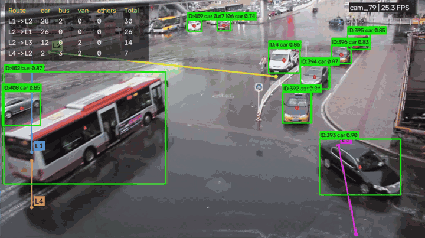
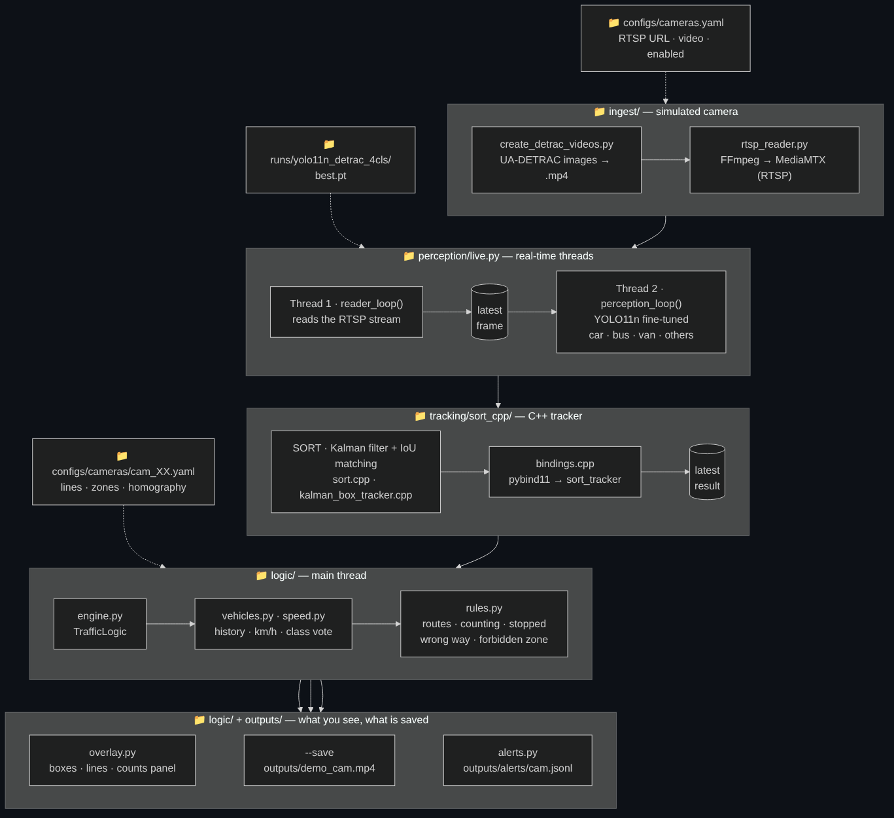

# SeeDrive

**Real-time traffic analysis from road cameras: detection, multi-object tracking, speed estimation and traffic rules, on a simulated RTSP camera.**

First step of a perception project that goes from roadside camera analytics toward autonomous-driving perception.

<p align="center">
  
</p>


---

## What it does

- **Simulated live camera**: a UA-DETRAC video is published as an RTSP stream (FFmpeg → MediaMTX) and read like a real IP camera.
- **Detection**: YOLO11n fine-tuned on UA-DETRAC (official train / test split), 4 classes: car, bus, van, others.
- **Tracking**: SORT re-implemented in **C++** (Kalman filter + IoU matching, Eigen), exposed to Python with **pybind11**, benchmarked against ByteTrack with TrackEval (HOTA, MOTA, IDF1).
- **Speed**: image → ground homography, speed in km/h over a 1 s window, smoothed.
- **Traffic logic**, configured by one YAML file per camera:
  - origin → destination route counting between named lines (L1 → L2, …), per class
  - counting per direction on a line
  - stopped vehicle, wrong-way driving, vehicle in a forbidden zone → live alerts + JSONL log
- **Real time**: 3 threads (reader / perception / display) that always work on the newest frame. If the pipeline is slower than the camera, it skips frames instead of falling behind.

## Architecture

<p align="center">
  
</p>

### How a frame goes through the live pipeline

`python main.py --camera cam_79` starts everything:

1. **Simulated camera** (`ingest/rtsp_reader.py`): FFmpeg reads the camera's video at its real speed (25 FPS) and publishes it to the MediaMTX RTSP server. The camera list is in `configs/cameras.yaml`.
2. **Read frames** (`perception/live.py`, thread 1): OpenCV reads the RTSP stream and puts each frame in a *latest frame* slot. An old frame is simply replaced by the new one.
3. **Detect + track** (`perception/live.py`, thread 2): YOLO11n detects the vehicles, then our C++ SORT (`tracking/sort_cpp/`, imported as `sort_tracker`) gives each one an ID. `add_classes()` gives each track the class and confidence of the detection it overlaps. The result goes to a *latest result* slot.
4. **Traffic logic** (`logic/engine.py`, main thread): `TrafficLogic` loads the camera's scene (`configs/cameras/cam_79.yaml`), updates each vehicle's history and speed (`vehicles.py`, `speed.py`), then runs the rules (`rules.py`): route counts, line counts, stopped vehicles, wrong way, forbidden zones.
5. **Outputs**: `logic/overlay.py` draws the boxes, lines and counts panel; `logic/alerts.py` shows red banners and logs each alert to `outputs/alerts/<camera>.jsonl`; `--save` records the display to `outputs/demo_<camera>.mp4`.

### Two files per camera

- `configs/cameras.yaml`: **how to reach the camera** (id, RTSP URL, source video, `enabled`).
- `configs/cameras/<id>.yaml`: **what to analyse in its image** (lines, routes, zones, homography). Every section is optional: a camera without homography simply has no speed.

## Results

### Detection (UA-DETRAC)

| Detector | Data | Precision | Recall | mAP50 | mAP50-95 |
|---|---|---|---|---|---|
| YOLO11n pre-trained (COCO car/bus/truck) | test split | TODO | TODO | TODO | TODO |
| YOLO11n fine-tuned, 1 class (vehicle) | test split | TODO | TODO | TODO | TODO |
| YOLO11n fine-tuned, 1 class (vehicle) | validation split | 97.3 | 94.2 | 97.8 | 75.9 |
| YOLO11n fine-tuned, 4 classes | validation split | 83.4 | 77.6 | 82.2 | 65.9 |

Per class (4-class model, validation): car 95.7, bus 97.2, van 77.3, others 58.6 mAP50. Vans are often confused with cars, and "others" has very few examples.
The 4-class mAP is an average over classes, so it is not directly comparable with the 1-class model.

Fine-tuning: 960 px input, early stopping, about 2 h on an RTX 3060 Laptop (6 GB). Unlabeled areas of UA-DETRAC ("ignored regions") are masked in the training images. Reproduce: `python -m perception.compare_detectors`.

### Tracking (TrackEval)

| Tracker | Detections | HOTA | MOTA | IDF1 | ID switches |
|---|---|---|---|---|---|
| SORT (ours, C++) | YOLO11n | TODO | TODO | TODO | TODO |
| ByteTrack (Ultralytics) | YOLO11n | TODO | TODO | TODO | TODO |

Reproduce: `python -m tracking.save_detections`, `python -m tracking.convert_gt`, `python -m tracking.run_sort`, `python -m tracking.evaluate`.

### Real time

| | Value |
|---|---|
| Live throughput (1 camera, RTX 3060 Laptop, 960 px) | 25 FPS (the camera's own rate) |
| End-to-end latency (frame read → display) | TODO ms |

## Quick start

Tested on Windows with Python 3.12 and an NVIDIA GPU. FFmpeg must be in the PATH.

```bash
# 1. Python environment
python -m venv seedrive
seedrive\Scripts\activate
pip install torch --index-url https://download.pytorch.org/whl/<your CUDA version>   # see pytorch.org
pip install -r requirements.txt

# 2. Build the C++ tracker (CMake + a C++17 compiler; Eigen is downloaded if missing)
cmake -S tracking/sort_cpp -B tracking/sort_cpp/build
cmake --build tracking/sort_cpp/build --config Release

# 3. Data: download UA-DETRAC into datasets/, then make the camera videos
python -m ingest.create_detrac_videos

# 4. Start the RTSP server (MediaMTX binary in the project root), then run a camera
mediamtx
python main.py --camera cam_79            # intersection + route counting
python main.py --camera cam_01 --simulate # highway + speed + alerts (demo: directions swapped)
python main.py --camera cam_79 --save     # also records outputs/demo_cam_79.mp4
```

The camera must have `enabled: true` in `configs/cameras.yaml`. Press `q` to stop.

Model weights are not stored in the repository: train them with `python -m perception.build_yolo_dataset` then `python -m perception.train_detector`, or download `best.pt` from the Releases page into `runs/yolo11n_detrac_4cls/weights/`.

## Add a camera

1. Add it to `configs/cameras.yaml` (id, RTSP URL, source video).
2. Create `configs/cameras/<id>.yaml`. Example (`cam_79`):

```yaml
camera: cam_79
sequence: MVI_40892
lines:                         # route counting: 1st line crossed = origin, next one = destination
  - name: L1
    points: [[70, 345], [70, 110]]
  - name: L2
    points: [[110, 120], [620, 175]]
routes:                        # rows of the counts panel
  - [L1, L2]
  - [L2, L1]
```

3. Optional: `homography` (speed, made with `python -m logic.calibrate`), `counting_line`, `zones` (forbidden / expected direction) and `thresholds` (alerts). See `configs/cameras/cam_01.yaml`.
4. Check the scene before running it: `python -m logic.scene --camera <id>`.

## Project structure

```
SeeDrive/
├── main.py                      entry point: live pipeline on one camera (--camera, --simulate, --save)
├── requirements.txt
│
├── configs/                     every setting in one place
│   ├── config.py                paths and constants (dataset, outputs, FPS, C++ build folder)
│   ├── helpers.py               small shared helpers (model loading)
│   ├── cameras.yaml             how to reach each camera: RTSP URL, source video, enabled
│   ├── cameras/cam_XX.yaml      what to analyse in each camera: lines, routes, zones, thresholds
│   └── homography/<seq>.json    image -> ground calibration, used for speed
│
├── ingest/                      simulated cameras
│   ├── create_detrac_videos.py  UA-DETRAC image folders -> .mp4 videos
│   └── rtsp_reader.py           loads cameras.yaml, starts FFmpeg -> MediaMTX (RTSP), stops it
│
├── perception/                  detection and the live pipeline
│   ├── live.py                  live pipeline: reader thread, perception thread (YOLO + SORT), display
│   ├── build_yolo_dataset.py    UA-DETRAC XML -> YOLO dataset (4 classes, ignored regions masked)
│   ├── check_yolo_labels.py     draws YOLO labels on images to check the conversion
│   ├── train_detector.py        fine-tunes YOLO11n -> runs/
│   ├── compare_detectors.py     COCO model vs fine-tuned model on the test split (mAP)
│   ├── inference.py             first threaded RTSP + YOLO pipeline, with per-stage timings
│   ├── latency.py               latency statistics for each stage of the pipeline
│   └── shared_slot.py           "latest value" slot shared between threads
│
├── tracking/                    multi-object tracking
│   ├── sort_cpp/                SORT in C++ (Eigen) + pybind11 module "sort_tracker"
│   │   ├── include/, src/       iou, kalman_box_tracker, matching, sort, bindings
│   │   └── CMakeLists.txt       builds the library, C++ tests and the Python module
│   ├── save_detections.py       runs YOLO on a sequence, saves boxes (MOT format)
│   ├── check_detections.py      draws saved detections to check them
│   ├── convert_gt.py            UA-DETRAC XML -> MOT ground truth + ignored regions
│   ├── check_gt.py              draws the ground truth to check it
│   ├── run_sort.py              SORT (C++) and ByteTrack on the same detections
│   └── evaluate.py              TrackEval scores: HOTA, MOTA, IDF1
│
├── logic/                       understanding the traffic
│   ├── engine.py                TrafficLogic: runs speed, counts and rules for one camera
│   ├── vehicles.py              one object per tracked vehicle: history, speed, direction, class vote
│   ├── speed.py                 ground point of a box, speed over 1 s, smoothing
│   ├── rules.py                 geometry + RouteCounter, LineCounter, stopped, wrong way, forbidden zone
│   ├── scene.py                 loads and draws a camera's scene YAML
│   ├── overlay.py               drawing: boxes, "ID class conf" tags, lines, counts panel
│   ├── alerts.py                alert banners on screen + JSONL log
│   ├── calibrate.py             click 4 ground points -> homography JSON
│   ├── check_homography.py      loads a homography, bird's-eye view to check it
│   ├── pick_points.py           click on an image to get pixel coordinates (for the YAML)
│   ├── show_speeds.py           replays a sequence with speeds (offline check)
│   └── replay.py                replays a sequence with all the logic, from saved tracks
│
├── assets/                      demo GIF of this README
├── datasets/                    UA-DETRAC (not in the repository)
├── runs/                        training results and weights (not in the repository)
└── outputs/                     detections, TrackEval files, alerts, demo videos (not in the repository)
```

## Limitations

- **Simulated cameras**: real videos, but replayed from files; no network losses or camera failures.
- **One camera at a time** for now.
- **Speed** depends on a manual 4-point calibration and on a flat road; the bottom-center of the box only approximates where the vehicle touches the ground.
- **SORT** has no appearance model: when vehicles overlap, IDs can switch, and a vehicle that changes ID between two lines is not counted.
- **Lines and zones** are drawn by hand for each camera.
- **Classes**: vans are often confused with cars, and "others" (rare in UA-DETRAC) is detected poorly.
- UA-DETRAC was filmed in Beijing and Tianjin (day, night, rain); the system was not tested on other countries' roads.

## Roadmap

- [ ] Multi-camera real-time (one batched YOLO, one tracker per camera)
- [ ] ONNX → TensorRT FP16, then INT8
- [ ] Benchmark: accuracy / FPS / latency / number of cameras in parallel

## Credits

- [UA-DETRAC](https://detrac-db.rit.albany.edu/) benchmark (research use)
- [Ultralytics YOLO11](https://github.com/ultralytics/ultralytics) and its ByteTrack implementation
- SORT: Bewley et al., *Simple Online and Realtime Tracking*, 2016
- [TrackEval](https://github.com/JonathonLuiten/TrackEval), [MediaMTX](https://github.com/bluenviron/mediamtx), [Eigen](https://eigen.tuxfamily.org/), [pybind11](https://github.com/pybind/pybind11)